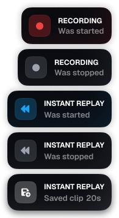

# Overplay for OBS Studio

Overplay shows desktop notifications when OBS starts or stops recording, starts
or stops the replay buffer, or saves a replay. The native OBS plugin is written
in C. It sends events over a Windows named pipe to the Tauri overlay.

## Preview

### Notification Types


### Animation Preview


## Install from a release archive

The Windows x64 release archive targets OBS Studio 33 or later.

1. Close OBS Studio.
2. Download and extract the Windows x64 archive from [GitHub Releases](https://github.com/qhouz/overplay/releases).
3. Copy the extracted `overplay` folder into `%ProgramData%\obs-studio\plugins\`.
   If you use portable OBS, copy it into the `plugins\` folder at the root
   of your portable OBS installation instead.
4. Start OBS Studio. Overplay launches its overlay automatically.

For a standard installation, the final paths should look like this:

```text
%ProgramData%\obs-studio\plugins\overplay\overplay.dll
%ProgramData%\obs-studio\plugins\overplay\data\manifest.json
%ProgramData%\obs-studio\plugins\overplay\data\overplay.exe
```

See the [OBS plugin layout guide](https://obsproject.com/kb/legacy-plugin-developer-info).

## Build on Windows x64

Install Node.js, pnpm, Rust with the MSVC toolchain, Visual Studio C++ Build
Tools, CMake 3.28 or newer, and the WebView2 runtime. The OBS build dependencies
are pinned in `plugin/buildspec.json`.

### PowerShell

Run from the repository root.

```powershell
Set-Location overlay
pnpm install --frozen-lockfile
pnpm tauri build --no-bundle
Copy-Item .\src-tauri\target\release\overplay.exe ..\plugin\data\overplay.exe -Force
Set-Location ..\plugin

cmake --fresh --preset windows-x64 -DENABLE_FRONTEND_API=ON
cmake --build build_x64 --config Release
```

`pnpm build` produces the web frontend in `overlay/dist`. The Tauri
build runs that frontend build and produces the desktop executable.

### Install into OBS

Close OBS Studio and run this command from `plugin/`:

```powershell
cmake --install build_x64 --config Release
```

The default Windows install location is `%ProgramData%\obs-studio\plugins\`.

### Stage files for a release archive

From `plugin/`, use `--prefix Release` to write the package to a local
directory. Start with an empty staging directory when upgrading from the
legacy layout.

```powershell
cmake --install build_x64 --config Release --prefix Release
```

```text
plugin/Release/overplay/
    overplay.dll
    data/manifest.json
    data/overplay.exe
    data/locale/en-US.ini
```

## Linux

Overplay's OBS integration currently requires Windows. The plugin launches
`overplay.exe` and sends events through a Windows named pipe. Linux users
can build the web frontend with Node.js and pnpm.

Run from the repository root in Bash.

```bash
cd overlay
pnpm install --frozen-lockfile
pnpm build
```

The output in `overlay/dist/` is the web frontend. Live OBS notifications
on Linux require a Linux implementation of the plugin-to-overlay connection.
